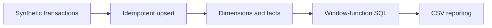

# Architecture and engineering decisions

> **Scope:** a local reference implementation using invented/synthetic inputs. No production deployment or service-level claims are implied.

## Executable SQL modelling and reporting

**Actual processing path:** Seeded sales/refund events --> Validated SQLite upserts by source ID --> Dimensions and facts --> Analytical SQL + window functions --> CSV reports.

## Key files

- `queryatlas/warehouse.py`: schema setup, deterministic event ingestion and reports.
- `queryatlas/sql/schema.sql`: dimensional design and indexes.
- `queryatlas/sql/daily_report.sql` and `retention_report.sql`: SQL analytics.

## Failure modes / trust boundaries

Seven active-day window calculations are not always seven calendar days. SQLite is used to make the exercise executable without cloud credentials; this is not proof of warehouse-scale performance.

## What I would build next

Watermarks and late arrivals, batch lineage, query plan benchmarks, external OLAP engine.

## Reviewer checklist

1. Read the source and confirm the processing path above.
2. Follow `docs/DEMO.md` and run the tests locally.
3. Inspect CI and document any divergence between local and GitHub results.
4. Treat all benchmarks as synthetic demonstrations unless proven otherwise.
